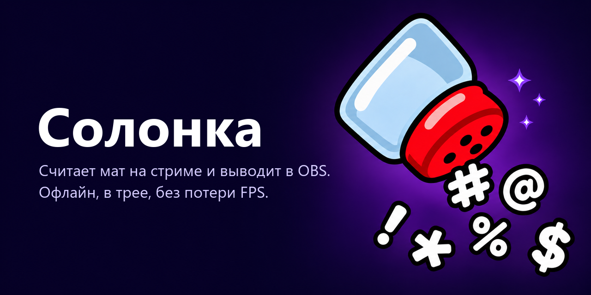
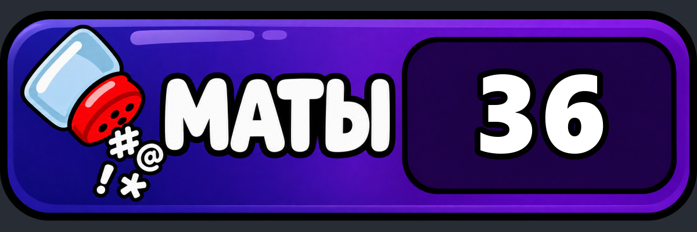

<p align="center"></p>

<p align="center">
  <a href="https://github.com/denprog5/solonka/releases/latest"></a>
  
  <a href="LICENSE"></a>
</p>

**Солонка** слушает микрофон и считает русский мат. Число выводится в OBS, а сама программа тихо сидит в трее.

- **Ловит любые формы.** Речь распознаёт нейросеть GigaAM v2 от Сбера, и она пишет слова по буквам, без словаря. Поэтому находятся и «хуесос», и «похуист», и «съебался», и «распиздяйство».
- **Не трогает FPS.** В тишине программа почти не нагружает процессор, а во время речи занимает около 10% одного ядра. Работает с пониженным приоритетом и на энергоэффективных ядрах.
- **Работает офлайн.** Звук никуда не отправляется, всё распознаётся на вашем компьютере.
- **Три режима сброса:** вручную, каждый день или при старте стрима в OBS.
- **Обновляется сама** с GitHub.

## Установка

1. Скачайте `Solonka-Setup-<версия>.exe` со [страницы релизов](https://github.com/denprog5/solonka/releases/latest). Файл весит около 160 МБ, потому что нейросеть внутри.
2. Запустите его. Права администратора не нужны, программа ставится в ваш профиль.

> Установщик не подписан сертификатом. Поэтому Windows может показать окно «Windows защитила ваш компьютер». Нажмите **Подробнее → Выполнить в любом случае**.

После запуска в трее появится солонка. Её вид показывает состояние:

| Иконка | Что значит |
|---|---|
| красная крышка | слушает микрофон |
| серая | на паузе |
| жёлтая точка | загружается нейросеть, это занимает около секунды |
| красный «!» | ошибка, текст есть в меню |

## Подключение к OBS

<p align="center"></p>

Солонка пишет в файл только число. Надпись и оформление берутся с готовой подложки, которую установщик кладёт рядом с этим файлом. Оба файла лежат в одной папке, её открывает пункт меню «Папка с файлом для OBS».

1. **Подложка.** В OBS: **Источники → «+» → Изображение** → файл `%APPDATA%\Solonka\overlay.png`.
2. **Число.** **Источники → «+» → Текст (GDI+)**. Поставьте галочку **«Читать из файла»** и выберите `%APPDATA%\Solonka\count.txt`.
3. **Оформление числа.** Шрифт — Segoe UI Black или Arial Black, цвет белый. Включите обводку: чёрная, толщина 8–10. Поставьте число в тёмное окошко справа на подложке.

Число в OBS обновляется через 1–2 секунды после сказанного.

**Сброс при старте стрима.** В OBS откройте **Инструменты → Настройки сервера WebSocket** и включите сервер. Затем в меню Солонки выберите **Автосброс → При старте стрима**. Порт и пароль Солонка берёт из настроек OBS сама.

## Меню в трее

- **Слушать микрофон** включает и выключает распознавание. Когда оно выключено, микрофон не захватывается совсем.
- **Обнулить счётчик** сбрасывает число до нуля.
- **Микрофон** выбирает устройство ввода.
- **Автосброс** задаёт, когда счётчик обнуляется:
  - только вручную;
  - каждый день — новые сутки начинаются в 05:00, чтобы ночной стрим не делился пополам;
  - при старте стрима в OBS.
- **Открыть настройки** открывает `config.json`, а **Перечитать настройки** применяет правки без перезапуска.
- **Запускать вместе с Windows** включает и выключает автозапуск.
- **Проверить обновления** ищет новую версию на GitHub.

## Настройки: `%APPDATA%\Solonka\config.json`

| Поле | Что делает |
|---|---|
| `template` | Текст в файле для OBS, вместо `{count}` подставляется число. По умолчанию `{count}` — только число, подпись есть на подложке |
| `extra_words` | Свои слова для счёта. Например, `шлюх*` засчитывает всё, что начинается на «шлюх» |
| `ignore_words` | Слова, которые не считать |
| `vad_min_level` | Порог тишины от 0 до 1. Если программа реагирует на фоновый шум, увеличьте. Если пропускает тихую речь, уменьшите |
| `day_start_hour` | Час начала суток для ежедневного сброса |
| `output_file` | Свой путь к файлу для OBS |
| `obs_url`, `obs_password` | Задавайте, только если OBS запущен на другом компьютере |
| `auto_update` | Ставить обновления автоматически (`true`) или только сообщать о них (`false`) |
| `eco_mode` | Держать программу на энергоэффективных ядрах |

## Как работают обновления

Через 15 секунд после запуска и потом раз в 6 часов Солонка проверяет, нет ли новой версии на GitHub.

- **Новая версия найдена при запуске.** Солонка ставит её сама и перезапускается. Скачивается около 7 МБ, нейросеть повторно не качается. Обычно программа стартует вместе с Windows, то есть до игры и стрима.
- **Новая версия найдена позже.** Солонка только предлагает её в меню, чтобы не перезапускаться посреди эфира.

Настройки и счётчик при обновлении сохраняются.

## Нагрузка

Замеры на Ryzen 7 7800X3D:

| | Процессор | Память |
|---|---|---|
| тишина | ~0,1% одного ядра | ~290 МБ |
| речь | ~10% одного ядра | ~290 МБ |

Тишину отсекает детектор голоса, и нейросеть получает только фразы. Почти вся память — это сама нейросеть.

## Сборка из исходников

Нужны [Rust](https://rustup.rs) (MSVC) и [Inno Setup 6](https://jrsoftware.org/isinfo.php).

```
winget install JRSoftware.InnoSetup --scope user
powershell -ExecutionPolicy Bypass -File scripts\build-installer.ps1
```

Скрипт собирает программу, скачивает модель и кладёт в `dist\` два установщика:

- `Solonka-Setup-<версия>.exe` — полный;
- `Solonka-Update-<версия>.exe` — без модели, для автообновления.

Для разработки:

- `cargo test` — тесты;
- `powershell -File scripts\fetch-model.ps1 -Dest target\debug` — скачать модель для отладочной сборки;
- `target\debug\solonka.exe --wav запись.wav` — прогнать WAV через распознавание и посмотреть, что насчиталось.

## Благодарности

- [GigaAM](https://github.com/salute-developers/GigaAM) (MIT) — модель распознавания русской речи;
- [sherpa-onnx](https://github.com/k2-fsa/sherpa-onnx) (Apache-2.0) — запуск модели;
- [cpal](https://github.com/RustAudio/cpal) и [tray-icon](https://github.com/tauri-apps/tray-icon) — звук и трей.

## Лицензия

[MIT](LICENSE)
